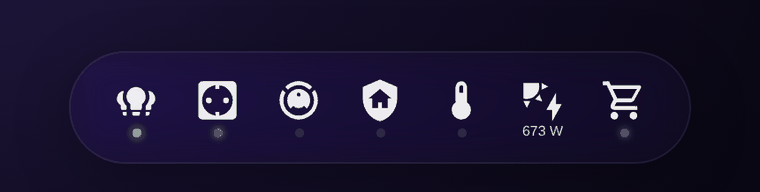
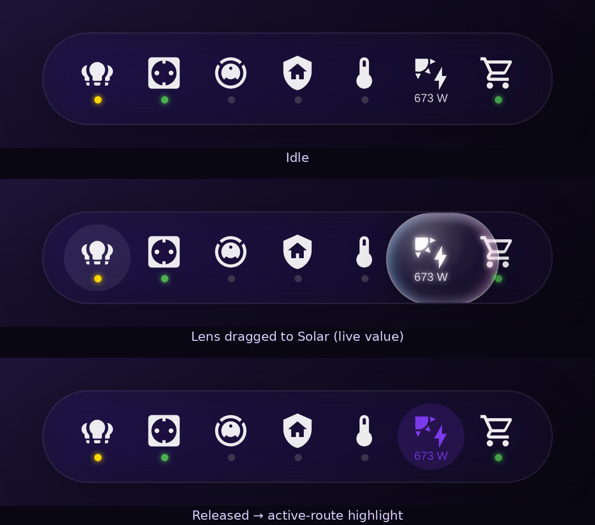
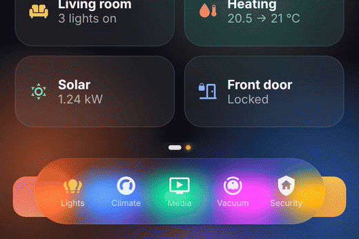
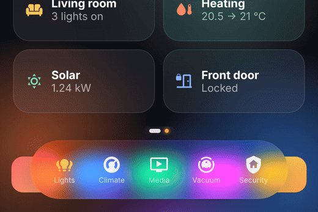

# 🧊 Liquid Lens Navbar Card

A bottom navigation bar for Home Assistant dashboards with an **iOS-26-style
"liquid glass" lens** that follows your finger as you drag across the bar —
plus per-route status dots, a live value readout, JS-templated icon
colors/pulse, a persistent active-route highlight, and a scrollable bar for
displays that can't fit every route at once.

- Drag across the bar and a frosted glass lens tracks your finger, with a
  soft light-refraction fringe at the edges — it trails the finger
  slightly, squashes with speed like a drop of liquid, and glides onto the
  icon you release on
- Icons switch popups as the lens settles on them — no need to lift your
  finger, just drag and let go on whatever you want (see
  [Navigation timing](#navigation-timing-hover_delay--release_only) for how
  that "settling" behaves and how to tune or disable it)
- Optional colored status dots per route (e.g. "is anything running?"),
  each driven by its own JS template evaluated against live entity states
- Optional icon recoloring the same way (`icon_color`), plus the icon
  symbol itself can be templated (`icon`)
- Optional live value readout per route (`value_entity`/`value_color`) —
  e.g. current solar production wattage under a Solar icon
- Optional pulsing icon (`pulse`) for anything that needs attention, e.g. a
  triggered alarm
- The currently open route is highlighted persistently by a pill that
  slides to whichever route is active, independent of the drag-hover lens
- **Modes** (new in 1.6.0): several route sets in one bar — swipe the bar
  up or down to switch, e.g. an everyday "Home" set and a "Tech" set. The
  glass morphs its width between them, and a dot above the bar lights up
  if something in a hidden mode needs attention. See [Modes](#modes)
- **Peek** (new in 1.6.0): while the lens rests on an icon, a small glass
  card above the bar shows that route's live summary (text and up to four
  bars); letting go opens the full popup as usual. See [Peek](#peek)
- **Visibility** (new in 1.7.0): show routes or whole modes only to certain
  users or while an entity is in a certain state, using the same
  conditions as Lovelace card visibility. One card can serve the whole
  family and the admin. See [Visibility](#visibility)
- If routes don't fit in the available width, the bar scrolls
  horizontally — drag the lens to the edge and it keeps auto-scrolling
- Light haptic pulse (native on the Companion App, `navigator.vibrate`
  fallback in-browser) as the lens crosses into a new icon
- Theme-aware: icons use `var(--primary-text-color)`, so they stay legible
  in both light and dark themes
- Respects `prefers-reduced-motion`: animations become short fades

On a real dashboard:




Feature close-ups (demo page, demo data):

| Drag the lens | Peek | Swipe between modes | Live status |
| :-: | :-: | :-: | :-: |
|  |  |  |  |

> Built for and tested against Home Assistant's `sections` dashboard type,
> alongside [Bubble Card](https://github.com/Clooos/Bubble-Card) pop-ups
> for navigation targets. It doesn't depend on Bubble Card, but the
> hash-based `#my-popup` navigation style matches how Bubble Card pop-ups
> listen for hash changes.

## Installation

### HACS (custom repository)

1. HACS → the `⋮` menu (top right) → **Custom repositories**
2. Add this repository's URL, category **Dashboard**
3. Install **Liquid Lens Navbar Card**, then reload your browser

### Manual

1. Download `liquid-lens-navbar-card.js` from this repo
2. Copy it to `<config>/www/liquid-lens-navbar-card.js`
3. Settings → Dashboards → Resources → add resource:
   - URL: `/local/liquid-lens-navbar-card.js`
   - Type: JavaScript Module
4. Hard-refresh your browser (and fully restart the Companion App if you
   use it, since it caches resources more aggressively than a browser tab)

## Basic usage

```yaml
type: custom:liquid-lens-navbar-card
routes:
  - icon: mdi:lightbulb-group
    label: Lights
    tap_action:
      action: navigate
      navigation_path: "#lights-popup"
  - icon: mdi:power-socket-de
    label: Outlets
    tap_action:
      action: navigate
      navigation_path: "#outlets-popup"
  - icon: mdi:thermometer
    label: Climate
    tap_action:
      action: navigate
      navigation_path: "/lovelace-home/climate"
```

Place the card as the **last card** in your dashboard's section/view — it
renders itself `position: fixed` at the bottom of the screen regardless of
where it sits in the layout, so its position in the YAML doesn't matter,
but keeping it last avoids confusing the visual editor.

## Config reference

| Option         | Type    | Required | Description                                                                                |
| -------------- | ------- | -------- | ------------------------------------------------------------------------------------------- |
| `routes`       | array   | yes*     | The icons in the bar, in order. See below. *Not needed if `modes` is set.                   |
| `modes`        | array   | no       | Several route sets you switch between by swiping the bar vertically. See [Modes](#modes).   |
| `peek_delay`   | number  | no       | How long (ms) the lens must rest on an icon before its peek appears (default: `120`).      |
| `hide_labels`  | boolean | no       | Hide the text label under every icon (default: `false`, labels shown).                      |
| `icon_size`    | number  | no       | Size in px of each icon (default: `24`).                                                    |
| `item_gap`     | number  | no       | Gap in px between buttons in the bar (default: `4`). Raise this if icons are hard to hit accurately. |
| `button_size`  | number  | no       | Width/height in px of each tap target (default: `54`).                                      |
| `lens_width`   | number  | no       | Width in px of the tracking lens. Defaults to `button_size + item_gap * 2` so it keeps covering one button's worth of space as those change. |
| `max_width`    | number  | no       | Max width in px of the visible bar "window" (default: fills the screen, `calc(100vw - 32px)`). See [Scrolling](#scrolling--overflow) below. |
| `hover_delay`  | number  | no       | How long (ms) the lens must sit on an icon before its popup loads (default: `130`). See [Navigation timing](#navigation-timing-hover_delay--release_only). |
| `release_only` | boolean | no       | If `true`, popups never open mid-drag — only when you release the lens over an icon (default: `false`). |

`hide_labels`, `icon_size`, `item_gap`, `button_size`, `lens_width`, and
`max_width` also have a visual editor (open the card in the dashboard
editor and click "Edit" instead of "Show code editor"). `hover_delay` and
`release_only` are YAML-only for now.

### Route object

| Option         | Type   | Required | Description                                                                                            |
| -------------- | ------ | -------- | ------------------------------------------------------------------------------------------------------- |
| `icon`         | string | yes      | Any `mdi:` icon name, or a `[[[ ... ]]]` template returning one. See [Templates](#templates).           |
| `label`        | string | no       | Text under the icon. Ignored per-route if `hide_labels: true` on the card.                              |
| `tap_action`   | object | no       | `navigate` or `call-service`/`perform-action`. See below.                                                |
| `icon_color`   | string | no       | A CSS color, or a `[[[ ... ]]]` template. See [Templates](#templates).                                   |
| `dots`         | array  | no       | Small status dots rendered under the icon. Each item: `{ color: <string or template> }`.                 |
| `value_entity` | string | no       | An entity ID whose state (plus unit, if any) renders as a small live readout under the icon.             |
| `value_color`  | string | no       | A CSS color, or a `[[[ ... ]]]` template, coloring the `value_entity` readout. Ignored without `value_entity`. |
| `pulse`        | string | no       | A `[[[ ... ]]]` template returning a boolean. When true, the icon pulses (scale + fade) — e.g. for a triggered alarm. |
| `peek`         | object | no       | Mini overview shown above the bar while the lens rests on this route. See [Peek](#peek).                 |
| `visibility`   | array  | no       | Conditions; the route is only shown while all of them pass. See [Visibility](#visibility).               |

### `tap_action`

Two action types are supported:

```yaml
tap_action:
  action: navigate
  navigation_path: "#some-popup"   # hash navigation (e.g. Bubble Card pop-ups)
# or
  navigation_path: "/lovelace-home/some-view"   # normal HA view navigation
```

```yaml
tap_action:
  action: perform-action   # or the legacy alias "call-service"
  service: light.toggle    # e.g. domain.service
  target:
    entity_id: light.living_room
  service_data: {}          # optional
```

The route whose `navigation_path` matches the current `location.hash` (or,
for plain view paths, the current `location.pathname`) is highlighted
persistently — independent of, and in addition to, the transient
drag-hover highlight.

### Templates

`icon`, `icon_color`, `value_color`, `pulse`, and `dots[].color` all accept
either a plain value, or a JS expression wrapped in `[[[ ... ]]]` and
evaluated live against `hass.states` on every state change. `states` is a
plain object keyed by `entity_id`, mirroring `hass.states` — **not** a
Jinja/Python template, this is JavaScript.

```yaml
icon_color: "[[[ return states['alarm_control_panel.home'].state.startsWith('armed') ? '#F44336' : null; ]]]"
```

```yaml
icon: "[[[ return states['weather.home'].state === 'rainy' ? 'mdi:weather-rainy' : 'mdi:weather-sunny'; ]]]"
```

```yaml
pulse: "[[[ return states['alarm_control_panel.home'].state === 'triggered'; ]]]"
```

`icon`/`icon_color`/`value_color` should `return` a string (an `mdi:` icon
name or a CSS color) or `null`/`undefined` to fall back to the default
(theme text color for icons, neutral gray for dots, no override for
values). `pulse` should return a boolean.

Multiple entities:

```yaml
dots:
  - color: >-
      [[[
        const vacuums = ['vacuum.a', 'vacuum.b'];
        return vacuums.some(e => states[e] && states[e].state === 'cleaning')
          ? '#00BFA5' : null;
      ]]]
```

> ⚠️ These templates run as raw `new Function(...)` in the browser. Only
> use templates you wrote or trust — this card does not sandbox them
> beyond what the browser itself does.

### Live value readout

```yaml
- icon: mdi:solar-power
  label: Solar
  tap_action:
    action: navigate
    navigation_path: "#solar-popup"
  value_entity: sensor.solar_power
  value_color: "[[[ const v = parseFloat(states['sensor.solar_power'].state); return (!Number.isFinite(v) || v < 1) ? null : '#FFD700'; ]]]"
```

Renders the entity's current state (plus its `unit_of_measurement`, if any)
as a small line under the label. `value_color` is optional and follows the
same template convention as `icon_color`.

### Scrolling / overflow

If the routes don't fit inside `max_width` (or the screen width, by
default), the bar becomes horizontally scrollable. Rather than a plain
swipe-to-scroll, scrolling is driven by the same lens-drag gesture used for
navigation: drag the lens to within ~36px of the visible edge and the icon
row keeps auto-scrolling underneath it — the lens stays pinned to your
finger at the screen edge while more routes scroll into view. Releasing
the drag on a partially-clipped edge route smooth-scrolls it fully into
view instead of leaving it half cut off.

### Navigation timing (`hover_delay` / `release_only`)

By default, a route's `tap_action` fires once the lens has sat on it,
motionless, for `hover_delay` (130ms) — not on every icon merely crossed
while dragging. This keeps a fast swipe from rapidly mounting and
unmounting a popup for every icon in between, which is especially
noticeable as jank on iOS. Haptic feedback still fires immediately on
every icon crossed, regardless of the delay. **Releasing the drag always
finalizes navigation immediately**, even if `hover_delay` hasn't elapsed
yet.

Set `release_only: true` to disable hover-triggered navigation entirely —
popups then only ever open when you lift your finger off an icon, never
mid-drag. This overrides `hover_delay`.

### Modes

Use `modes` instead of `routes` to put several route sets into one bar.
Swipe the bar **up** for the next mode, **down** for the previous one (it
wraps around). While you swipe, the bar follows your finger with a little
resistance; once you've pulled far enough, a short tick and a label with
the target mode's name tell you that letting go will switch. The new icons
morph in, the glass grows or shrinks to the new number of routes, and the
dots above the bar show which mode is active.

```yaml
type: custom:liquid-lens-navbar-card
modes:
  - name: Home
    routes:
      - icon: mdi:lightbulb-group
        label: Lights
        tap_action: { action: navigate, navigation_path: "#lights-popup" }
      - icon: mdi:thermostat
        label: Climate
        tap_action: { action: navigate, navigation_path: "#climate-popup" }
      - icon: mdi:shield-home
        label: Security
        tap_action: { action: navigate, navigation_path: "#security-popup" }
  - name: Tech
    routes:
      - icon: mdi:server
        label: Server
        tap_action: { action: navigate, navigation_path: "#server-popup" }
        dots:
          - color: "[[[ return states['binary_sensor.server_problem'].state === 'on' ? '#ff5252' : null; ]]]"
      - icon: mdi:solar-power-variant
        label: Energy
        value_entity: sensor.solar_power
        tap_action: { action: navigate, navigation_path: "#energy-popup" }
      - icon: mdi:update
        label: Updates
        tap_action: { action: navigate, navigation_path: "#updates-popup" }
        dots:
          - color: "[[[ return Number(states['sensor.pending_updates'].state) > 0 ? '#ffa726' : null; ]]]"
```

| Mode option | Type   | Required | Description                                                                                       |
| ----------- | ------ | -------- | -------------------------------------------------------------------------------------------------- |
| `routes`    | array  | yes      | The routes of this mode — same route objects as above.                                             |
| `name`      | string | no       | Shown briefly above the bar when switching to this mode.                                           |
| `path`      | string | no       | A view path (e.g. `/my-dashboard/tech`). Switching to the mode navigates there, and opening that view switches to the mode. |
| `visibility` | array | no       | Conditions; the whole mode is skipped while they don't pass. See [Visibility](#visibility).        |

- **The mode follows the URL.** If a popup or view that belongs to another
  mode gets opened (by a link, a button elsewhere, browser back), the bar
  switches to that mode, so the active route is always visible.
- **Alerts in hidden modes stay visible.** A hidden mode's dot takes the
  first status color returned by any `dots[].color` template of its
  routes. Templates should therefore return `null` for "all fine" (as in
  the example) and a color only when something needs attention —
  otherwise the dot would glow all the time.
- **Different modes for different people.** Give a mode (or a route) a
  `visibility` list — see [Visibility](#visibility). Before 1.7.0 this
  needed two cards with card-level visibility conditions.
- A plain `routes` config is simply one mode: no dots, no swipe, exactly
  the behavior of earlier versions.

### Visibility

Routes and modes accept a `visibility` list with the same conditions as
[Lovelace card visibility](https://www.home-assistant.io/dashboards/cards/#showing-or-hiding-a-card-conditionally).
All conditions in the list must pass. That way one card can serve
everyone: the family gets a plain bar, and the admin gets the same routes
plus a second mode.

```yaml
type: custom:liquid-lens-navbar-card
modes:
  - name: Home
    routes:
      - icon: mdi:lightbulb-group
        label: Lights
        tap_action: { action: navigate, navigation_path: "#lights-popup" }
      - icon: mdi:power-socket-eu
        label: Plugs
        tap_action: { action: navigate, navigation_path: "#plugs-popup" }
      - icon: mdi:robot-vacuum
        label: Vacuum
        tap_action: { action: navigate, navigation_path: "#vacuum-popup" }
        # only while the vacuum isn't docked
        visibility:
          - condition: state
            entity: vacuum.robot
            state_not: docked
      - icon: mdi:shield-home
        label: Security
        tap_action: { action: navigate, navigation_path: "#security-popup" }
      - icon: mdi:thermostat
        label: Climate
        tap_action: { action: navigate, navigation_path: "#climate-popup" }
  - name: Tech
    visibility:
      - condition: user
        users:
          - 0123456789abcdef0123456789abcdef   # the admin's user ID
    routes:
      - icon: mdi:server
        label: Server
        tap_action: { action: navigate, navigation_path: "#server-popup" }
      - icon: mdi:solar-power-variant
        label: Energy
        tap_action: { action: navigate, navigation_path: "#energy-popup" }
      - icon: mdi:docker
        label: Services
        tap_action: { action: navigate, navigation_path: "#services-popup" }
```

Everyone else only sees the "Home" routes, as a plain bar with no mode
dots and no swiping. The admin sees the same bar plus the dots and can
swipe to "Tech". User IDs are listed under *Settings → People → Users*
(with advanced mode turned on in your user profile).

Supported conditions:

| Condition       | Example                                                                                              |
| --------------- | ----------------------------------------------------------------------------------------------------- |
| `user`          | `{ condition: user, users: [<user id>, ...] }`                                                        |
| `state`         | `{ condition: state, entity: input_boolean.guests, state: "on" }` — or `state_not`; either may be a list |
| `numeric_state` | `{ condition: numeric_state, entity: sensor.power, above: 100, below: 3000 }`                         |
| `and` / `or`    | `{ condition: or, conditions: [ ... ] }`                                                              |
| `not`           | `{ condition: not, conditions: [ ... ] }` — passes unless all inner conditions pass, like Lovelace   |

- A hidden route isn't rendered at all, so the lens, a swipe or a peek
  can't reach it. A mode is hidden when its own conditions fail or when
  none of its routes are visible.
- If only one mode is left, the bar behaves like a plain `routes` bar: no
  mode dots, no swiping.
- If the current URL belongs to a hidden route, nothing is highlighted.
- Conditions are re-checked when the user or one of the entities they
  read changes. The buttons are rebuilt only when the set of visible
  routes actually changes, and never in the middle of a drag (the change
  is applied on release).
- Until Home Assistant has passed its state to the card, routes and modes
  with conditions stay hidden. That way family members never see admin
  routes flash up while the page loads.
- Other Lovelace condition types (`screen`, `time`, `location`, …) aren't
  supported yet. They count as passing and log a console warning once.

### Peek

Give a route a `peek` and dragging across the bar becomes "look first":
while the lens rests on that icon, a small glass card above the bar shows
a live summary, with a little arrow pointing at the icon. Slide on and the
card follows; let go and the route's popup opens as usual. Sliding off the
bar (more than ~90px up in a single-mode bar) closes the peek without
opening anything. A quick tap still opens the popup right away.

```yaml
- icon: mdi:lightbulb-group
  label: Lights
  tap_action: { action: navigate, navigation_path: "#lights-popup" }
  peek:
    text: >-
      [[[ const on = Object.keys(states).filter((e) => e.startsWith('light.') && states[e].state === 'on');
          return on.length ? on.length + ' on' : 'All off'; ]]]
- icon: mdi:solar-power-variant
  label: Energy
  tap_action: { action: navigate, navigation_path: "#energy-popup" }
  peek:
    text: "[[[ return 'Solar ' + states['sensor.solar_power'].state + ' W'; ]]]"
    bars:
      - label: Solar
        value: "[[[ return states['sensor.solar_power'].state; ]]]"
        max: 2000
        color: "#ffc857"
      - label: Battery
        value: "[[[ return states['sensor.battery_level'].state; ]]]"
```

| Peek option | Type   | Description                                                                                       |
| ----------- | ------ | -------------------------------------------------------------------------------------------------- |
| `title`     | string | Heading of the card. Defaults to the route's `label`.                                              |
| `icon`      | string | Icon next to the title. Defaults to the route's `icon` (and uses its `icon_color`).                |
| `text`      | string | Summary text; `\n` starts a new line.                                                              |
| `bars`      | array  | Up to four small bars: `{ label, value, max (default 100), color }`.                               |

Every field may be a plain value or a `[[[ ... ]]]` template, and the card
updates live while it is open. Routes with a `peek` never open their popup
mid-drag (the peek takes that place); routes without one keep the normal
`hover_delay` behavior. Peek pairs well with `release_only: true`.

## Known limitations

- **No real optical distortion.** The lens uses blur/saturation/brightness
  plus faked chromatic-fringe shadows to *suggest* glass refraction — true
  pixel-level distortion (`feDisplacementMap` via `backdrop-filter`) was
  tested and found unreliable across WebKit-based WebViews (specifically,
  it did not render at all in the HA Companion App's WKWebView, even
  though the same technique works in desktop/mobile Safari). If Apple's
  actual Liquid Glass shader ever becomes accessible from CSS, this could
  be revisited.
- Every icon must have an entry in `routes`; there's no built-in "more"
  overflow menu for bars with many icons — either let the bar scroll (see
  above) or group related items into a single popup with sub-sections.
- The card's styles are not scoped per instance, so two navbar cards with
  *different* sizing options visible on the same page at the same time
  share one set of sizes. Use one card with `modes` and
  [`visibility`](#visibility), or cards whose visibility conditions never
  overlap.
- Not tested with a fixed `header` bar or a dashboard using `type: masonry`
  (only `type: sections`).

## Design notes / FAQ

**Why does my navbar look cramped with 6+ icons?**
Consider merging related, less-frequently-used icons into one route whose
popup shows all of them directly (headings + content, not more taps) —
rather than adding a generic catch-all "more" menu, which tends to feel
like a dumping ground. A collapsed `custom:expander-card` per section
inside that popup keeps heavy content (camera feeds, maps) from loading
until the user actually opens that section. Alternatively, set a
`max_width` smaller than the screen and let the bar scroll.

**The popup opens/closes animation feels slow.**
If you're using [Bubble Card](https://github.com/Clooos/Bubble-Card)
pop-ups as navigation targets, their default transition is roughly
0.3–0.5s. You can override it with
[card-mod](https://github.com/thomasloven/lovelace-card-mod):

```yaml
card_mod:
  style: |
    .bubble-pop-up { transition: transform 0.18s cubic-bezier(0.2, 0.8, 0.3, 1) !important; }
    .bubble-backdrop { transition: opacity 0.15s ease-out !important; }
```

**Popups still feel janky on a fast swipe.**
Raise `hover_delay` (e.g. to 180–250ms), or set `release_only: true` to
only ever navigate on release. See
[Navigation timing](#navigation-timing-hover_delay--release_only).

## Changelog

### v1.7.0

- **Visibility**: new `visibility` option on routes and modes, using the
  same conditions as Lovelace card visibility (`user`, `state`,
  `numeric_state`, `and`, `or`, `not`). One card can now serve family and
  admins instead of two cards with card-level conditions. Hidden routes
  are not rendered, hidden modes are skipped when swiping, and a bar with
  a single visible mode looks and behaves like a plain `routes` bar. See
  [Visibility](#visibility).
- Conditions are only re-evaluated when the user or an entity they read
  changes, and the buttons are only rebuilt when the visible set really
  changes — never mid-drag.
- Mode dots only count alerts from routes this user can see.
- Fully backwards compatible: configs without `visibility` render exactly
  as before.

### v1.6.0

- **Modes**: new `modes` option — several route sets in one bar, switched
  by swiping the bar up/down. Mode dots above the bar, a name toast, an
  alert color on hidden modes' dots, optional `path` per mode, and the
  mode follows the current URL. `routes` configs are unchanged.
- **Smoother mode switch**: outgoing icons leave in the swipe direction
  while the new ones spring in, and the glass morphs its width instead of
  jumping. Rubber-band pull with a haptic tick and a preview of the
  target mode once the swipe is far enough to switch.
- **Liquid lens**: the lens now eases after the finger and squashes with
  speed, glides onto the chosen icon on release, and no longer flashes up
  on a quick tap. It is moved with `transform` and button positions are
  measured once per drag instead of every frame (cheaper on phones).
- **Sliding active pill**: one highlight slides between routes instead of
  the highlight jumping from button to button.
- **Peek**: optional `peek` per route — a live mini overview card above the
  bar while the lens rests on an icon; releasing opens the popup as before.
  New `peek_delay` option.
- **`prefers-reduced-motion`** is respected: short fades, no spring, no pulse.
- **Fixes**: a route targeting `/view#popup` no longer lights up for every
  popup on that view; a slow start of a vertical swipe no longer opens the
  popup under the finger; window listeners are removed when the card
  leaves the page; the mode label stays inside the card in the editor.

### v1.5.1

- **Template caching**: templates for `icon`, `icon_color`, `value_color`,
  `pulse`, and `dots[].color` are now compiled once per unique template
  string and cached on the card instance, instead of being re-parsed via
  `new Function(...)` on every `set hass` call (which fires on every state
  change anywhere in Home Assistant, not just for entities this card
  cares about). No functional change, just less repeated work as the
  number of templated routes grows.

### v1.5.0

- **Scrollable bar**: new `max_width` option caps the bar's width; routes
  that overflow it scroll horizontally, with the drag-lens gesture
  auto-scrolling at the visible edges and snapping a clipped edge route
  fully into view on release.
- **Persistent active-route highlight**: the route matching the current
  hash/view path stays visually marked, independent of the drag-hover
  highlight, and stays in sync with hash changes, view navigation, and
  browser back/forward.
- **`pulse` template**: routes can pulse their icon based on a live JS
  template (e.g. a triggered alarm), following the same convention as
  `icon_color`.
- **Live value readout coloring**: new `value_color` template option for
  the existing `value_entity` readout.
- **Navigation timing controls**: popups now only load once the lens
  settles on an icon (`hover_delay`, default 130ms) instead of firing on
  every icon crossed during a fast drag — fixes noticeable jank on iOS.
  New `release_only` option disables hover-triggered navigation entirely,
  so popups only ever open on release.
- **Editor/dialog fix**: edit-mode detection now crosses shadow-DOM
  boundaries and checks for any enclosing `ha-dialog`, fixing a bug where
  the card's own `position: fixed` styling could render on top of (and
  block taps on) the card editor dialog's Save button.

## License

MIT — see [LICENSE](LICENSE).

## Credits

Built iteratively in conversation with Claude (Anthropic) against a real
Home Assistant dashboard, then cleaned up for public release.
